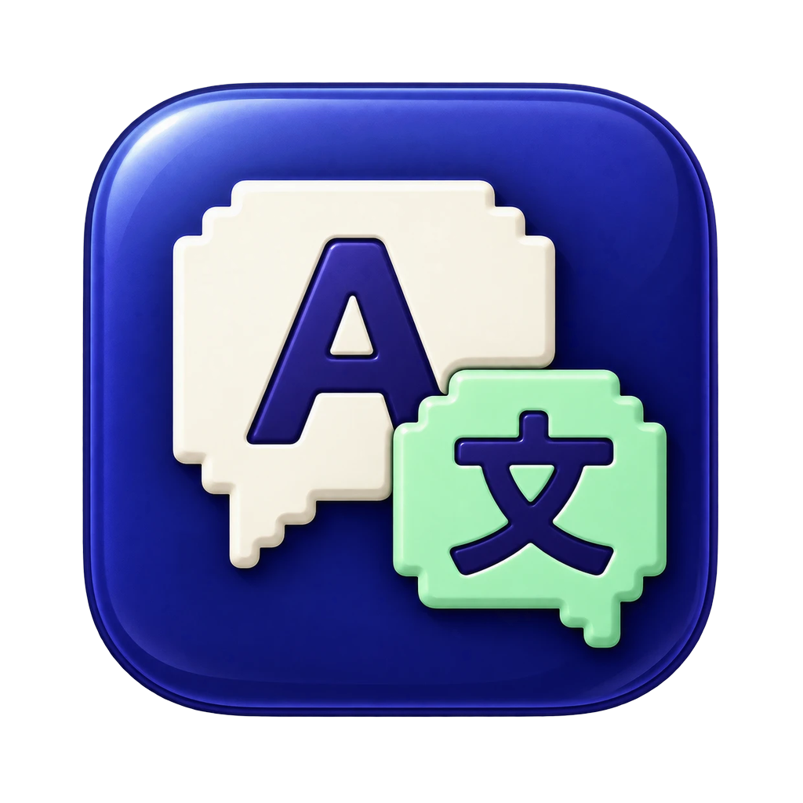

<p align="center"></p>

# GameLingo

**English** · [繁體中文](#繁體中文說明)

A macOS menu-bar companion for playing English games in **OpenEmu**: it reads the dialogue box,
translates it into **Traditional Chinese (Taiwan)** with a **local** model, and shows both languages in a
floating window. Click any word to see its definition and word roots, save it, and review it later with
spaced-repetition flashcards. **Everything runs on your Mac**: no cloud, no account, and nothing changes
in OpenEmu or your ROMs.

### Why GameLingo

GameLingo was made by a longtime retro gamer. Many of the classic RPGs we grew up with were best in their
English versions, full of witty writing, regional accents and old-fashioned words, but stopping every few
lines to look things up kills the fun. GameLingo lets you **keep playing the old games you love while
picking up English along the way**: the translation appears right beside the game, any word you are
curious about is one click away, and the words you save come back as flashcards built from the very line
you saw them in. Learning from a story you care about sticks far better than memorizing a word list.

### Features

- **Auto translation**: detects the dialogue box, waits until the text stops typing, then OCRs it (Apple Vision) and translates it (Seed-X-PPO-7B on MLX, about 0.5 s per line).
- **Floating window** that never steals keyboard focus from the game. Lines stack up as color blocks.
- **Proper nouns stay in English** (placeholder protection plus your own name list).
- **Click-to-define**: ECDICT definitions converted to Taiwan Traditional Chinese, pronunciation, and word-root breakdown (MorphoLex), e.g. `dis- + appear + -ance`.
- **💡 Context explanation**: asks the model to explain the dialect, grammar and word choice of a line (about 15 s).
- **Word book and flashcards**: meaning cards and cloze cards built from the game sentence, scheduled with SM-2, plus same-root word families. Type the answer on cloze cards, type a forgotten word to reinforce it, practise extra rounds without touching the schedule, and delete cards you no longer need.
- **Frees about 8 GB of memory** when OpenEmu is closed; settings window; launch at login.

### Requirements

- Apple Silicon Mac, **macOS 14+**, 16 GB RAM or more recommended (the 8-bit model uses about 8 GB)
- **Xcode** (for the Swift compiler) and [**uv**](https://github.com/astral-sh/uv) (`brew install uv`)
- About 25 GB of free disk space for the first build (model download and conversion)
- [OpenEmu](https://openemu.org/) in **windowed** mode

### Quick start

```bash
git clone https://github.com/map456/GameLingo.git
cd GameLingo
./build.sh                       # downloads the model and dictionaries on first run, then builds build/GameLingo.app
open build/GameLingo.app
```

On first launch, allow **Screen Recording** for GameLingo in System Settings → Privacy & Security → Screen & System Audio Recording, then reopen the app.
If you don't have an Apple Development certificate, the app is ad-hoc signed and you may need to allow it again after each rebuild.

### Limitations

- Tuned for **Dragon Quest IV (NDS)**: dialogue-box detection looks for DQ4's white frame, and the dialect word list comes from DQ4. Other games may need tweaks.
- OpenEmu only. The Seed-X model has no game context, so terms like "party" can be mistranslated.
- The UI is in Traditional Chinese.

### License

Code: [MIT](LICENSE). Models and data are downloaded separately and keep their own licenses. Notably,
**MorphoLex-en is CC BY-NC-SA 4.0 (non-commercial only)**. See [THIRD_PARTY_NOTICES.md](THIRD_PARTY_NOTICES.md).
GameLingo does not include any game ROMs or assets.

---

## 繁體中文說明

玩 OpenEmu 上的英文遊戲時，自動（或按快捷鍵）擷取對話框，**在本機**翻成繁體中文，並在浮動視窗裡中英對照顯示。可以點單字查詢、看字根拆解、收藏，再用單字卡（SM-2）複習。全程離線，不修改 OpenEmu 或 ROM。

### 為什麼做這個

作者是一個玩了很多年的遊戲老玩家。小時候玩過的經典 RPG，很多英文版其實寫得最精彩：俏皮的台詞、各地口音、古老的用字。但每看幾句就停下來查字典，遊戲的樂趣也跟著沒了。

GameLingo 想做的是：**繼續玩你喜歡的老遊戲，順便把英文學起來。**翻譯就顯示在遊戲旁邊，好奇的字點一下就能查，收藏的字會變成單字卡，用你當初在遊戲裡看到的那一句來複習。從自己在乎的故事裡學到的字，比背單字表記得牢多了。

### 系統需求

- Apple Silicon 的 Mac、**macOS 14 以上**，建議記憶體 16 GB 以上（模型約佔 8 GB）
- 已安裝 **Xcode**（只需要它的編譯器，不用打開）和 **uv**（`brew install uv`）
- 第一次編譯需要約 25 GB 硬碟空間（下載並轉換模型）
- OpenEmu 用**視窗模式**（不要全螢幕）

### 限制

- 針對《Dragon Quest IV》NDS 版調校：對話框偵測找的是 DQ4 的白色外框，方言字表也來自 DQ4，其他遊戲可能要調整。
- 只支援 OpenEmu。翻譯模型沒有遊戲語境，像 party 這類字可能翻錯（例如翻成「黨內同志」）。

## 第一次安裝

在「終端機」輸入：

```bash
git clone https://github.com/map456/GameLingo.git
cd GameLingo
./build.sh
```

看到綠色的「完成！」就代表成功了。第一次執行會自動下載模型（約 15 GB）和字典並轉換，需要一段時間。

## 開啟 App

```bash
open build/GameLingo.app
```

開啟後會發生這些事：
- 螢幕右上角的選單列多出一個「對話泡泡」圖示。
- 螢幕右上角出現半透明的翻譯視窗。
- 背景開始載入翻譯模型，約 5～20 秒。點選單列圖示，第一行顯示「模型：就緒」就可以用了。

### 授權「螢幕錄製」（第一次）

1. 第一次開啟時，系統會跳出視窗詢問 GameLingo 能否錄製螢幕。按「打開系統設定」。如果沒跳出來，就點選單列圖示 →「開啟螢幕錄製權限設定…」。
2. 在「螢幕與系統錄音」清單裡，打開 **GameLingo** 的開關。
3. 系統會要求結束並重新開啟 GameLingo，照著做；或是點選單列圖示 →「結束 GameLingo」，再執行一次上面的 `open` 指令。

App 用你的開發者憑證簽章，所以之後重新編譯也不用再授權一次。

## 使用方式

| 快捷鍵 | 功能 |
| --- | --- |
| ⌃⌥T（Control＋Option＋T） | 翻譯目前畫面上的對話 |
| ⌃⌥R | 重新擷取並翻譯（不使用快取，同一句也會重翻） |
| ⌃⌥H | 顯示／隱藏翻譯視窗 |
| ⌃⌥A | 開啟／關閉自動翻譯 |

**自動翻譯（預設開啟）**：用視窗模式玩遊戲（不要全螢幕），對話框的字打完、停住約 1 秒，就會自動翻譯，不用按任何鍵。翻譯視窗上方有綠色「自動」標籤時，代表自動翻譯正在運作。同一句不會重複翻譯。

**手動翻譯**：如果自動翻譯關掉了，或某句沒有自動翻到，就按 **⌃⌥T**。約 1 秒後，翻譯視窗會顯示英文原文（小字）和中文翻譯（大字）。

翻譯視窗的操作：
- **累積清單**：每句一張半透明卡片（上方英文、下方中文），新的一句接在最下面，並用粉紫色發光外框標示。舊的會保留（最多 100 句），重開 App 也會帶回最近 30 句。
- **查單字**：直接點英文句子裡的任何單字，視窗下方會出現青藍色字卡，有音標、中文釋義，變化形還會附上原形（例如 disappearing → disappear）。按喇叭可以聽發音，按 ⓧ 關閉字卡。
- **收藏**：字卡右上角的「☆ 收藏」會把單字（原形）連同遊戲原句和翻譯存進單字本；收藏過的字在句子裡會有黃色底色。再按一次「★ 已收藏」可以取消。
- **整句發音**：每句英文旁邊的小喇叭。
- **💡 語境解說**：每句英文旁邊的燈泡。點了會請翻譯模型詳細解說這句的方言、文法和用字（例如 cannae＝can't、yon＝that），約 10～20 秒，結果顯示在該句下方的黃色區塊，按 ︿ 收起。同一句再點會直接顯示，不用重新產生。
- **移動**：拖曳視窗上方空白處，位置會自動記住。
- **調整大小**：拖曳視窗邊緣。
- **✏️ 鉛筆**：OCR 讀錯字時，可以修正最後一句的原文，按 ⌘↩ 重新翻譯。翻完後鍵盤會自動還給遊戲。
- **↻**：重新翻譯（同 ⌃⌥R）。
- **🗑 垃圾桶**：清空清單。
- **✕**：隱藏視窗（按 ⌃⌥H 再叫出來）。

視窗不會搶走鍵盤，按完快捷鍵可以直接繼續操作遊戲。

## 單字本與單字卡

點選單列圖示，有兩個選項：

- **我的單字本（N 個）…**：列出所有收藏的單字、釋義和遊戲原句，可以搜尋、發音、刪除。
- **單字卡複習（今天 N 張）…**：複習今天到期的單字卡（翻譯視窗上方的粉紫色「複習 N」也能直接點）。

每個收藏的字有**兩種卡**，各自排程、交替出現（上方標籤會寫「意思」或「克漏字」）：

| 卡片 | 正面 | 要想的 |
| --- | --- | --- |
| 意思卡 | 單字、音標、遊戲原句（該字以金色底線標出） | 中文意思 |
| 克漏字卡 | 遊戲原句挖空（只露第一個字母，如 r＿＿＿＿＿＿）＋中文翻譯 | 空格裡的英文字 |

1. 看正面回想，按**空白鍵**翻面。
2. 背面有中文釋義、**字根拆解**（藍＝字首、橘＝字根、綠＝字尾，例如 rest ＋ -ful 充滿…的）和**同字根家族**（★ 黃色是你單字本裡已收藏的字，灰色是字典裡同家族的字）。
3. 依照記得的程度按 **1 忘記／2 困難／3 普通／4 簡單**，按鈕下方會顯示下次多久後再複習。
4. 按「忘記」的卡會在這一輪最後再考一次，並要你在輸入框把這個字**打對 2 次**才換下一張（可按「略過」；設定裡可關閉或改次數）。
5. **克漏字卡可以直接打答案**：游標會自動在輸入框裡，打完按 Return 會翻面並顯示答對或你打了什麼；想不起來就直接按 Return。
6. 不想再複習的字，按右上角的**垃圾桶**刪除（意思卡和克漏字卡一起刪）。
7. 今天的卡複習完，可以按「**只練忘記過的**」或「**全部再練一輪**」多練幾次。練習**不會改變**下次複習的日期。

點遊戲裡的英文單字時，字卡上也會顯示字根拆解。

排程用的是 SM-2：答對時間隔會越拉越長（1 天 → 6 天 → 約 15 天…），忘記就從頭開始。選單列圖示旁的數字是今天待複習的張數，翻譯視窗上方的粉紫色標籤也會顯示。遊玩時不會跳出提醒。

## 設定

點選單列圖示 →「設定…」（或在選單打開時按 ⌘,）：

| 項目 | 說明 |
| --- | --- |
| 自動翻譯、偵測間隔 | 0.5～3 秒，預設 1 秒 |
| 中文字級、英文字級、不透明度 | 翻譯視窗的外觀，改了立刻生效 |
| 釋放記憶體 | OpenEmu 關閉後（立刻／1／5／15 分鐘）卸載翻譯模型，釋放約 8 GB；查字典、複習單字卡照常可用；開 OpenEmu 或按翻譯時自動載回（約幾秒） |
| 登入時自動開啟 | 開機後自動啟動 GameLingo |
| 名字清單 | 直接在設定裡編輯、儲存 |

## 名字清單

主角的名字是你自己取的（例如取名 Xi 時，英文字典剛好有 xi 這個字，會被翻成「習」）。請一定要加入清單。點選單列圖示 →「編輯名字清單…」，用文字編輯打開清單後，一行寫一個名字，存檔後下一句就會生效。

## 紀錄

點選單列圖示 →「打開紀錄資料夾」，裡面有：
- `study.sqlite`：翻譯歷史、收藏的單字、單字卡排程（請勿手動修改）
- `history.jsonl`：每句的英文、中文和耗時
- `crops/`：每句的對話框截圖，用來檢查 OCR 有沒有讀錯，最多保留 300 張
- `server.log`：翻譯伺服器的紀錄，出問題時看這裡

## 結束

點選單列圖示 →「結束 GameLingo」。背景的翻譯伺服器也會一起關掉，釋放約 8 GB 記憶體。

## 專案結構

| 資料夾 | 內容 |
| --- | --- |
| `GameLingo/` | Swift App：選單列、快捷鍵、擷取、OCR、浮動視窗 |
| `server/` | 本機翻譯伺服器（Python）：Seed-X、專名保護、OpenCC 台灣正體 |
| `models/` | Seed-X-PPO-7B 的 MLX 8-bit 模型（不進版本控制） |
| `data/` | ECDICT 英漢字典（`ecdict.db`）與字根資料庫（`morph.db`），不進版本控制 |
| `stage0/` | 階段 0 驗證腳本與報表 |
| `build.sh` | 一鍵編譯 |

## 資料來源與授權

程式碼採 [MIT 授權](LICENSE)。模型與資料由 build.sh 另外下載，各自依原授權使用，詳見 [THIRD_PARTY_NOTICES.md](THIRD_PARTY_NOTICES.md)。

- 翻譯模型：Seed-X-PPO-7B（ByteDance，OpenMDW）
- 英漢字典與字根表：[ECDICT](https://github.com/skywind3000/ECDICT)（MIT）
- 單字拆解：[MorphoLex-en](https://github.com/hugomailhot/MorphoLex-en)（CC BY-NC-SA 4.0，**僅限非商業使用**）
- 字首字尾的中文意思：人工整理（`server/affix_zh.json`）；字根意思由 Seed-X 翻譯
